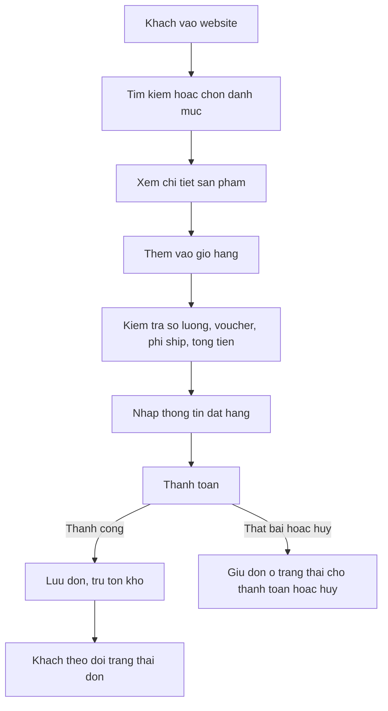
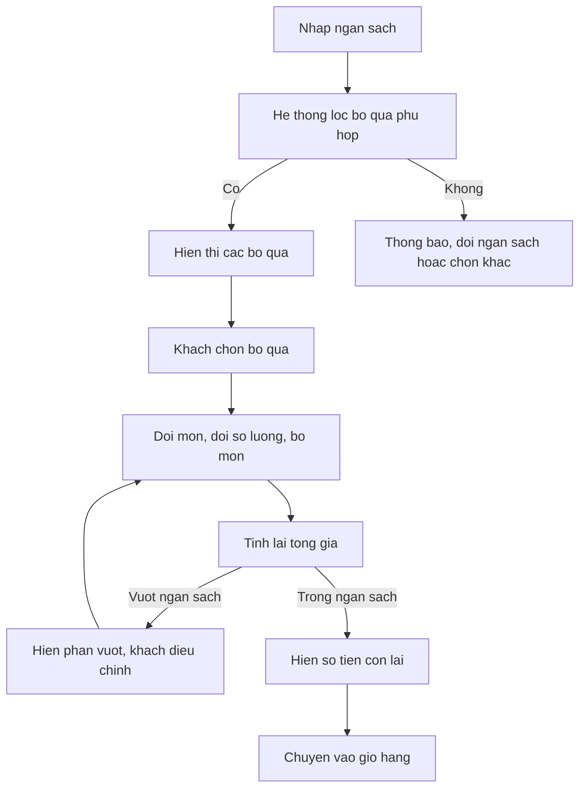
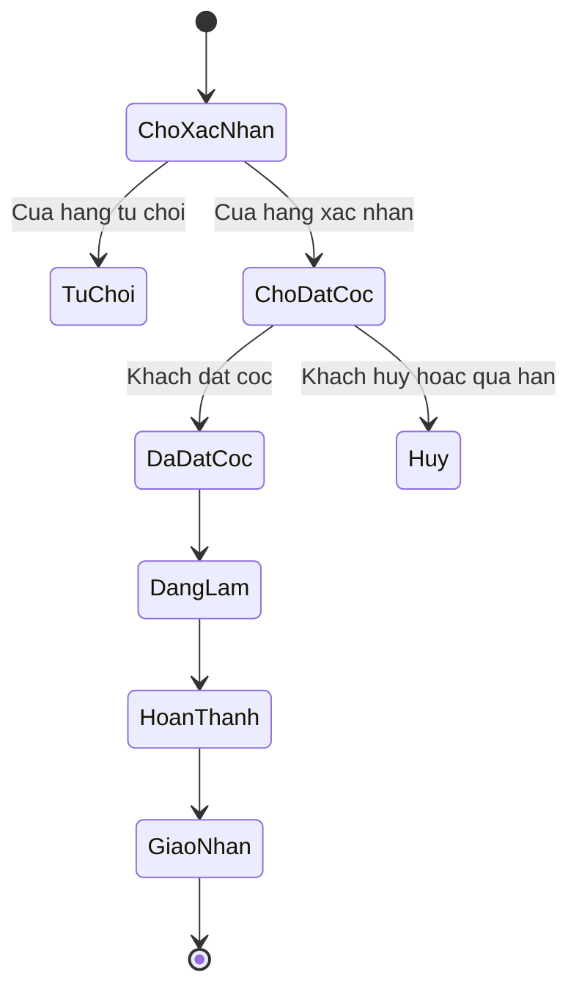

# Quy trình nghiệp vụ

> Bản nháp – nhóm rà soát. Sơ đồ dùng Mermaid (GitHub tự hiển thị).

## 1. Quy trình mua hàng (sản phẩm làm sẵn)
1. Khách truy cập website.
2. Tìm kiếm hoặc chọn danh mục sản phẩm.
3. Xem chi tiết sản phẩm.
4. Thêm vào giỏ hàng.
5. Kiểm tra số lượng, áp mã giảm giá, xem phí vận chuyển và tổng tiền.
6. Đăng nhập (nếu chưa) và nhập thông tin nhận hàng.
7. Chọn phương thức thanh toán và xác nhận đơn.
8. Hệ thống lưu đơn, cập nhật tồn kho, cập nhật trạng thái theo kết quả thanh toán.
9. Khách xem trạng thái đơn; cửa hàng xử lý và giao hàng.

## 2. Quy trình tạo giỏ quà theo ngân sách
1. Khách nhập ngân sách (vd 200.000đ).
2. Hệ thống lọc các bộ quà cấu hình sẵn có **tổng giá ≤ ngân sách** và **tất cả món còn hàng**.
3. Nếu không có bộ phù hợp: thông báo rõ, cho khách đổi ngân sách hoặc chọn thủ công.
4. Khách chọn một bộ quà.
5. Khách đổi món, đổi số lượng hoặc bỏ món (chỉ trong sản phẩm còn bán).
6. Sau mỗi thay đổi, hệ thống tính lại tổng; hiển thị **số tiền còn lại** hoặc **phần vượt ngân sách**.
7. Khách bấm chuyển vào giỏ hàng và tiếp tục quy trình mua hàng.

Quy tắc: ngân sách tính theo tổng giá sản phẩm hiện hành; phí vận chuyển/phát sinh hiển thị riêng khi checkout.

## 3. Quy trình đặt làm theo mẫu (tùy chọn có giá niêm yết)
1. Khách chọn mẫu cửa hàng hỗ trợ.
2. Chọn tùy chọn (màu, kích thước, thêm tên); hệ thống hiển thị tổng theo giá niêm yết.
3. Khách gửi yêu cầu đặt làm.
4. Nhân viên kiểm tra, xác nhận khả năng nhận làm và thời gian hoàn thành (hoặc từ chối kèm lý do).
5. Khách xác nhận; thực hiện bước đặt cọc theo quy định (**TODO: cách ghi nhận đặt cọc**).
6. Trạng thái: chờ xác nhận → đã đặt cọc → đang làm → hoàn thành → giao nhận.
7. Trường hợp hủy hoặc thanh toán thất bại: **TODO: nhóm quy định rõ**.

## 4. Quy trình yêu cầu riêng và báo giá (làm sau / cần xác minh)
Khách gửi mô tả/ảnh tham khảo → cửa hàng xem xét → báo giá + thời gian → khách xác nhận hoặc từ chối. Hệ thống **không** tự định giá từ ảnh.
